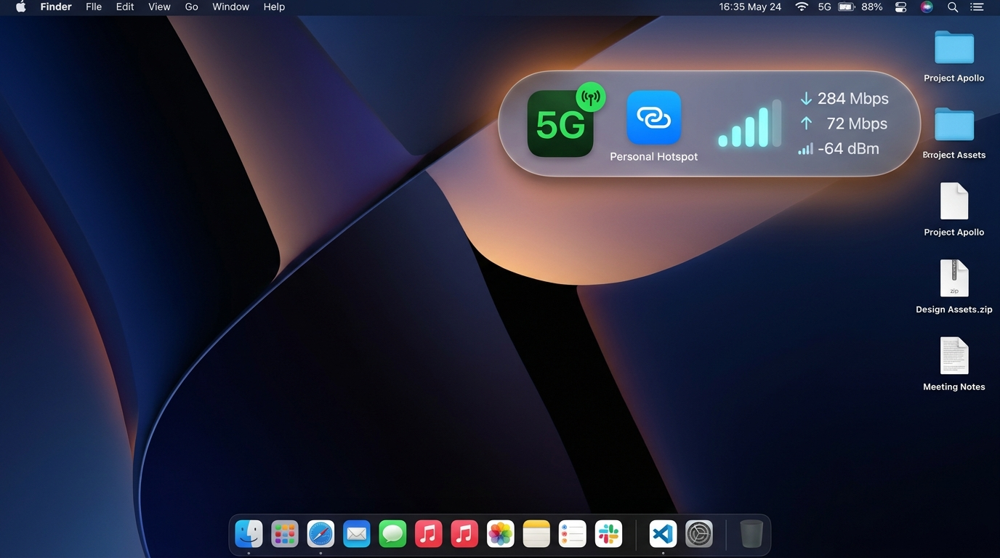

# AirHUD 📶

<p align="center">
  
</p>

<p align="center">
  <strong>A lightweight, standalone macOS native Heads-Up Display (HUD) for Wi-Fi and Personal Hotspot metrics.</strong>
</p>

<p align="center">
  <a href="https://github.com/nidsnitesh/AirHUD/releases"></a>
  <a href="#installation"></a>
  <a href="#installation"></a>
  <a href="#contributing"></a>
  <a href="LICENSE"></a>
</p>

---

## 🌟 Overview

**AirHUD** is an open-source, unobtrusive macOS menu bar accessory and floating overlay widget built with **Swift**, **SwiftUI**, **AppKit**, and **CoreWLAN**.

Designed for remote engineers, digital nomads, and presentation power users, AirHUD gives you instantaneous, glanceable insight into your network health. It detects whether you are on high-speed **5G/4G iPhone or Android Personal Hotspots** versus standard office/home Wi-Fi, showing real-time cellular tower bars and exact dBm signal metrics without opening menus or taking your eyes off full-screen apps.

---

## ✨ Features

- 🪄 **Dynamic Network Intelligence**:
  - Automatically identifies whether you are connected to a **Personal Hotspot** (via 300 TU beacon interval telemetry and SSID signatures) or **Standard Wi-Fi**.
  - Intelligently infers cellular generation:
    - **5G**: Solid vibrant green background (`#29C757`) with crisp white text.
    - **4G**: Solid alert red background (`#EB3840`) with crisp white text.
- 🔔 **5G → 4G Cellular Downgrade Alert**:
  - Exclusively for Personal Hotspots: sends a macOS system alert notification (with "Ping" audio feedback) when your connection drops from 5G to 4G LTE, keeping you aware of network throttling or cellular coverage drops.
- 📶 **Cellular Tower Bars Next to 5G / 4G**:
  - In Personal Hotspot mode, cellular tower signal bars (4 ascending bars) are displayed directly beside the `5G` / `4G` badge, showing live tower reception.
  - In standard Wi-Fi mode, the Wi-Fi icon and mint badge are displayed, with Wi-Fi signal metrics revealing on hover.
- 📐 **Ultra-Compact Idle & Smooth Expansion on Hover**:
  - **Ultra-Compact Idle State**: Shows exclusively the **`5G`** (or `4G` / `Wi-Fi`) badge pill with zero visual clutter.
  - **Hover State (`.onHover`)**: Expands horizontally with a fluid spring animation inside a stationary canvas to reveal the connection icon, cellular tower bars, signal strength (dBm), and a quick-close button.
- 🧲 **Magnetic Edge & Corner Snapping**:
  - Freely draggable anywhere across your monitors (`overlayPanel.isMovableByWindowBackground = true`).
  - Drop the HUD within 35pt of any screen edge or corner to dock it flush with a comfortable 16pt margin via smooth `0.15s` ease-out spring physics.
- 💾 **Position Persistence**:
  - Automatically remembers your preferred screen position in `UserDefaults`.
  - Re-anchors safely across system restarts, display resolution adjustments, and external monitor disconnects.
- 🌌 **Persistent Spaces & Fullscreen Support**:
  - Configured at `.screenSaver` window level with `.canJoinAllSpaces` and `.fullScreenAuxiliary`.
  - Floats smoothly on top of full-screen games, IDEs, keynote presentations, and video streams.
- 🚀 **Zero-Distraction Accessory App**:
  - Runs in accessory mode (`LSUIElement`), keeping your macOS Dock clutter-free.
  - Accompanied by a live macOS Menu Bar item featuring dynamic icons, status summaries, visibility toggles, and position reset.

---

## 📸 Screenshots & States

| Personal Hotspot (5G Active) | Personal Hotspot (4G Active) | Standard Wi-Fi (Home / Office) |
| :---: | :---: | :---: |
| Blue Hotspot icon • 🟢 **5G** (Solid Green, White text) • 4 green tower bars • `-52 dBm` | Blue Hotspot icon • 🔴 **4G** (Solid Red, White text) • Red tower bars • `-74 dBm` | Green Wi-Fi icon • 🟩 **Wi-Fi** Mint badge • Wi-Fi bars & `-50 dBm` |

---

## 🛠️ Installation & Quick Start

### Prerequisites
- macOS 13.0 (Ventura) or newer
- Xcode 15+ or Swift 5.9+ Command Line Tools (`xcode-select --install`)

### Option 1: 1-Click Download (Recommended)

Download the pre-compiled macOS app directly from GitHub Releases:

<p align="left">
  <a href="https://github.com/nidsnitesh/AirHUD/releases/latest/download/AirHUD.zip">
    
  </a>
</p>

1. **Download & Extract**: Download **[AirHUD.zip](https://github.com/nidsnitesh/AirHUD/releases/latest/download/AirHUD.zip)** and double-click to unzip.
2. **Move to Applications**: Drag `AirHUD.app` into your `/Applications` folder.
3. **Open & Enjoy**: Double-click `AirHUD.app` to launch. The HUD widget and menu bar icon will instantly appear.

> [!TIP]
> **First-Launch macOS Gatekeeper Note**:
> Because AirHUD is an open-source indie app distributed outside the Mac App Store without paid Apple Developer notarization:
> - Simply **Right-click (or Control-click)** on `AirHUD.app` and choose **Open**, then click **Open** in the dialog.
> - Alternatively, you can run `xattr -cr /Applications/AirHUD.app` in Terminal once.

---

### Option 2: Build & Run from Source (For Developers)

If you prefer building directly with Xcode / Swift:

```bash
# 1. Clone repository
git clone https://github.com/nidsnitesh/AirHUD.git
cd AirHUD

# 2. Run directly via Swift Package Manager
swift run

# 3. Or package your own standalone AirHUD.app bundle
chmod +x scripts/build_app.sh
./scripts/build_app.sh
```

---

## 🎮 Usage & Controls

- **Repositioning**: Click and drag anywhere on the glass card body to place it anywhere on screen. Release near an edge or corner to snap into place.
- **Hover Inspection**: Hover your cursor over the widget to reveal real-time bandwidth and signal level telemetry.
- **Hiding the Widget**:
  - Click the **`×`** button on the widget while hovering, or
  - Select **Hide HUD** from the status bar menu (`⌘H`).
- **Menu Bar Actions**:
  - **Show / Hide HUD**: Toggle overlay visibility on demand.
  - **Reset Position to Bottom-Right**: Resets the HUD to default coordinates with a 16pt margin.
  - **Quit AirHUD**: Cleanly exits the app (`⌘Q`).

---

## 📄 License

This project is licensed under the **MIT License**. See [LICENSE](LICENSE) for details.
